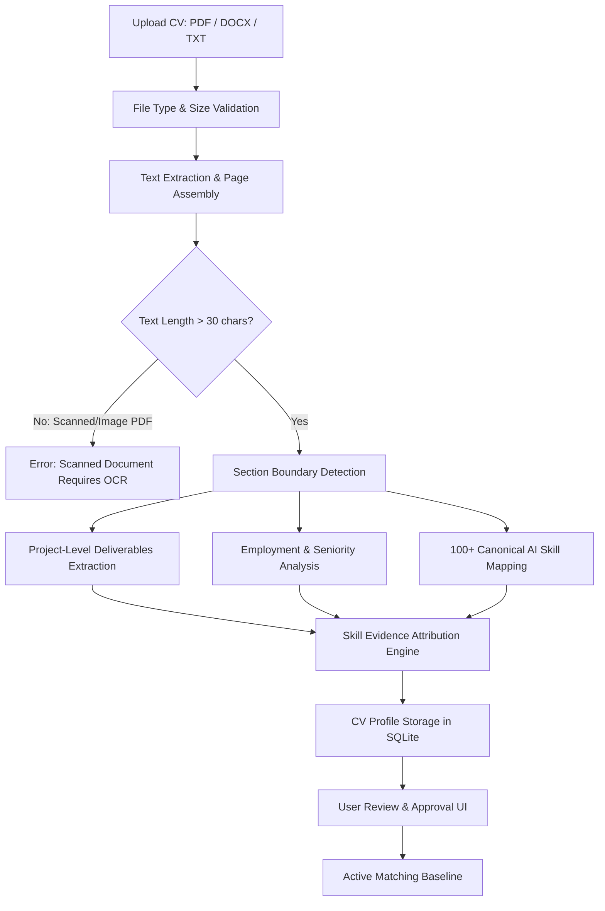

# DEEP CV INTELLIGENCE & PERSONALIZED OPPORTUNITY MATCHING
**Global AI Opportunities Intelligence Agent**
*Date: November 2, 2026 | Version: 2.0 | Status: Production Hardened*

---

## 1. Executive Summary & Design Mission

A fundamental limitation of conventional job search tools is shallow keyword matching: matching "Kubernetes" or "AWS" on an Engineering Manager listing leads to senior leadership recommendations for individual contributor engineers who have never managed a team.

The **Deep CV Intelligence Engine** transforms an uploaded resume (PDF, DOCX, or TXT) into a rich, structured **Skill & Experience Evidence Graph**. It differentiates between:
- Skills demonstrated through functional deliverables in named projects (Highest weight: 2.0x).
- Skills demonstrated in professional employment history (High weight: 1.5x).
- Skills listed in a generic skills summary (Baseline weight: 1.0x).
- Transferable skills inferred via controlled relationship graphs (0.5x).

---

## 2. Ingestion Pipeline & Privacy Guarantees

### Local Privacy Guarantee
- The application processes the candidate's CV **entirely locally in memory**.
- Zero external cloud transmission of personal data (phone numbers, addresses, personal summaries).
- Stored records can be reviewed, edited, or completely purged at any time via `DELETE /api/cv`.

---

## 3. Structured Data Model (`CVProfileModel`)

| Field Name | Type | Description |
|---|---|---|
| `id` | `String(64)` | Deterministic SHA-256 hash of extracted text |
| `filename` | `String(256)` | Original file name (e.g. `Mohamed_AI_Engineer_CV.pdf`) |
| `file_type` | `String(32)` | File format extension (`pdf`, `docx`, `txt`) |
| `professional_headline` | `String(256)` | Primary role title (e.g. `Computer Vision & AI Engineer`) |
| `career_summary` | `Text` | Executive professional summary |
| `years_of_experience` | `Float` | Calculated duration from employment history |
| `seniority_level` | `String(64)` | Classified level: `junior`, `intermediate`, `senior`, `lead`, `manager`, `principal` |
| `has_leadership_experience` | `Boolean` | Explicit flag for people management / direct reports |
| `technical_skills` | `JSON Array` | Extracted skill keywords |
| `normalized_skills` | `JSON Array` | Standardized canonical skills (e.g. `K8s` $\to$ `Kubernetes`) |
| `projects` | `JSON Array` | Structured project records with problem, domain, tech, and metrics |
| `skill_evidence` | `JSON Array` | Evidence links attributing skills to specific projects or roles |
| `approved` | `Boolean` | User approval flag required for active matching |
| `version` | `Integer` | Incrementing revision counter |

---

## 4. Skill Evidence Attribution Taxonomy

Every skill detected in the CV is classified into an evidence tier:

1. **`project` (Confidence: 0.95 | Weight: 2.0x)**:
   - Skill is explicitly used in a named project with functional deliverables (e.g. *"Implemented YOLOv8 and DeepLabV3+ for real-time defect segmentation at 45 FPS"*).
2. **`employment` (Confidence: 0.85 | Weight: 1.5x)**:
   - Skill is listed under employment roles and responsibilities.
3. **`skills_list` (Confidence: 0.65 | Weight: 1.0x)**:
   - Skill appears only in a generic "Technical Skills" bulleted block without contextual implementation proof.
4. **`inferred` (Confidence: 0.50 | Weight: 0.5x)**:
   - Skill is inferred from related technologies (e.g. PyTorch + FastAPI infers Model Deployment capability).

---

## 5. Experience-Level & Seniority Matching Guardrails

To prevent false-positive recommendations for management roles (such as the 90.2/100 Engineering Manager issue):

1. **Role Seniority Classification**:
   - `manager`: Job title or description requires people management, direct reports, or engineering leadership.
   - `principal`: Requires 8–10+ years industry-wide architecture leadership.
   - `lead`: Tech lead, team coordination.
   - `senior`: 5+ years hands-on production engineering.
   - `intermediate`: 2–4 years hands-on engineering.
   - `junior`: 1–2 years practical work.
   - `intern`: Student or entry.
2. **Strict Seniority Compatibility Gate**:
   - If role is `manager` and CV has `has_leadership_experience = False`:
     - **Penalty:** **-25.0 points** deducted from total score.
     - **Flag:** `seniority_compatibility = "incompatible_leadership"`.
     - **Recommendation:** `"Low Match (Seniority Mismatch)"`.
   - If role is `principal` and CV is `intermediate`:
     - **Penalty:** **-15.0 points** deducted.
     - **Flag:** `seniority_compatibility = "insufficient_seniority"`.

---

## 6. Review & Approval Workflow

1. **Upload**: User uploads resume via the dashboard ("My CV & Professional Profile" tab) or `POST /api/cv/upload`.
2. **Inspection**: The dashboard displays the extracted headline, calculated years of experience, classified seniority level, parsed projects, and attributed skill evidence tags.
3. **Edit & Confirm**: The user can modify any field (e.g. adjusting years of experience or adding missing skills).
4. **Approve**: Clicking "Approve Profile" sets `approved = True`. Future searches and ranking evaluations will automatically use this verified profile.

