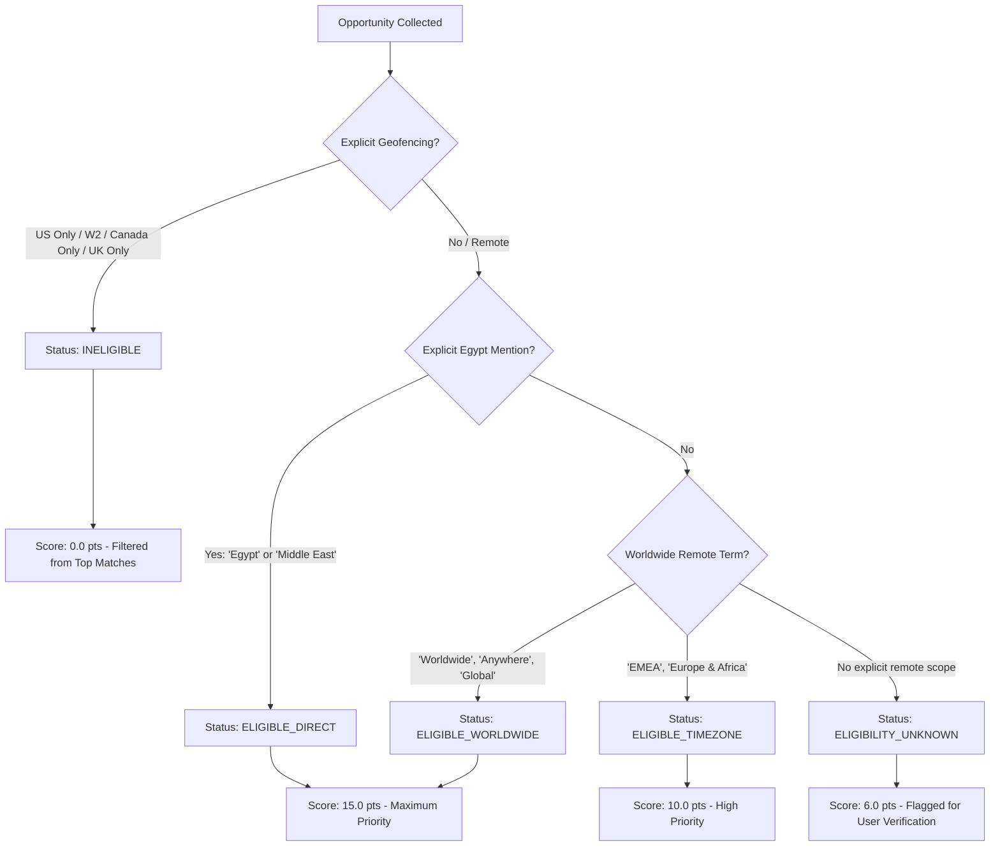

# EGYPT REMOTE WORK ELIGIBILITY & PAYMENT VERIFICATION AUDIT
**Global AI Opportunities Intelligence Agent**
*Date: November 2, 2026 | Focus: Cross-Border Contracts, Payout Channels & Compliance*

---

## 1. Executive Summary: The Egyptian Remote AI Context

Working remotely from Egypt for global tech companies and platforms involves specific legal, financial, and infrastructural realities:
1. **Contract Currency**: Contracts and compensation must be denominated in hard currency (**USD or EUR**) to maintain real value and offset domestic inflation.
2. **Payout Rails**: Egyptian freelancers and remote contractors face selective banking restrictions; traditional automated merchant payouts must map to supported local or intermediary financial rails.
3. **Timezone Compatibility**: Egypt operates in **UTC+2** (or UTC+3 during Summer DST), providing strong overlap with Europe/EMEA (0–2 hours difference) and viable working overlap with US East Coast mornings (5–6 hours difference).

---

## 2. Payout Channel Analysis for Egypt

| Payment Method | Viability in Egypt | Setup & Operational Realities | Feasibility Rating | Risk / Compliance Notes |
|---|---|---|---|---|
| **Payoneer** | **High (Standard Rail)** | Provides local virtual receiving bank accounts in the US (First Century Bank / Community Federal Savings Bank), EU, and UK. Enables direct withdrawal to Egyptian bank accounts (USD or EGP) or Payoneer Mastercard. | **9.5 / 10** | Very widely supported by Outlier, Appen, OneForma, Upwork, and Freelancer. Highly recommended. |
| **Direct Wire / SWIFT** | **High** | Direct international SWIFT transfer into an Egyptian bank USD account (e.g. CIB, QNB, HSBC Egypt, Banque Misr). Requires IBAN, SWIFT BIC, and intermediary bank routing. | **9.0 / 10** | Standard for Deel, Remote.com, and direct B2B corporate contracts. Incur $15–$30 intermediary bank wire fees; optimal for lump-sum transfers > $1,000. |
| **PayPal** | **Medium** | Egyptian PayPal accounts must be linked to an approved Visa card (such as Egyptian Post EasyPay Visa, QNB Visa, or CIB Visa) for automated monthly withdrawal. Mastercard and bank accounts cannot directly receive PayPal Egyptian withdrawals. | **7.0 / 10** | Mandatory payout channel for Scale AI / Outlier and Prolific. Requires verified Egyptian Visa card for balance sweeps. |
| **Wise (formerly TransferWise)** | **Medium-Low** | Personal Wise accounts in Egypt have limited features: opening new multi-currency balance accounts with local US account details for Egyptian residents has faced intermittent onboarding pauses. Receiving payouts via Wise transfers directly into Egyptian bank accounts via SWIFT is supported. | **6.0 / 10** | Viable when the employer funds a direct bank deposit via Wise; limited for self-managed borderless multi-currency balances. |
| **Cryptocurrency (USDT/USDC)** | **Strict Caution / Restricted** | The Central Bank of Egypt (CBE) Law No. 194 of 2020 explicitly prohibits dealing in, issuing, or promoting cryptocurrencies without a special CBE license. | **2.0 / 10 (High Risk Flag)** | The application must flag any opportunity mandating cryptocurrency payout with `RISK_LEVEL = HIGH` or `LEGAL_RESTRICTION_EGYPT` and caution the user. |

---

## 3. Geographic Eligibility Taxonomy & Verification Rules

Every opportunity is analyzed for geographic constraints using explicit evidence extraction:

### 3.1 Eligibility Status Categories
1. **`ELIGIBLE_DIRECT` (15.0 pts)**:
   - Job description or ATS metadata explicitly lists Egypt as an eligible hiring country (e.g. "We hire in Egypt, Poland, Brazil...").
2. **`ELIGIBLE_WORLDWIDE` (15.0 pts)**:
   - Stated as "Work from anywhere", "Worldwide remote", "Global contractor", or "100% Remote - Any location".
3. **`ELIGIBLE_TIMEZONE` (10.0 pts)**:
   - Stated as "EMEA friendly", "+/- 3 hours of UTC", or "Europe / Africa working hours". Compatible with Cairo timezone.
4. **`ELIGIBILITY_UNKNOWN` (6.0 pts)**:
   - Stated only as "Remote" without specifying country eligibility. The system flags this with a visual badge: `[Verification Needed: Scope Not Specified]`.
5. **`INELIGIBLE` (0.0 pts)**:
   - Stated as "US Citizens only", "US Only (W2/1099)", "Must reside in the European Union", "North America only", or mentions OFAC embargoes. Filtered out from top recommendations.

---

## 4. Contract Model Compatibility for Egypt

1. **Independent Contractor Agreement (B2B)**:
   - Most common model for US/European AI tech companies hiring Egyptian talent.
   - Payout via invoice or milestone platform.
   - Candidate is responsible for local Egyptian tax compliance (Egyptian Tax Authority freelance / sole proprietor registration).
2. **Employer of Record (EOR)**:
   - Companies using Deel, Remote.com, or Oyster HR can legally hire full-time employees in Egypt with local Egyptian labor law compliance, social insurance, and medical coverage, while paying in USD or EGP.
3. **Platform Contributor / Crowdsource Tasker**:
   - Model used by Outlier.ai, Alignerr, and Appen.
   - Tasks paid per hour or per accepted prompt/review.
   - Direct automated payout to Payoneer or PayPal without formal employment contracts.

---

## 5. Verification Rules in the Intelligence Pipeline

The `CountryEligibilityEvaluator` in `backend/app/intelligence/eligibility.py` implements these rules deterministically:
1. **Exclusion Check**: Scans for negative boundary regex: `\b(us\s+only|usa\s+only|us\s+citizens?\s+only|must\s+be\s+located\s+in\s+the\s+u\.?s\.?|authorized\s+to\s+work\s+in\s+the\s+us\s+without\s+sponsorship|w2\s+only|eu\s+only|uk\s+only)\b`.
2. **Worldwide Whitelist Check**: Scans for: `\b(anywhere\s+in\s+the\s+world|worldwide|global|work\s+from\s+anywhere|remote\s+internationally|all\s+locations)\b`.
3. **Direct Egypt Match**: Scans for: `\b(egypt|cairo|alexandria|middle\s+east|mena|north\s+africa)\b`.
4. **Payout Channel Matching**: Verifies whether the listing mentions supported payment rails (Payoneer, Deel, PayPal, Wire).

